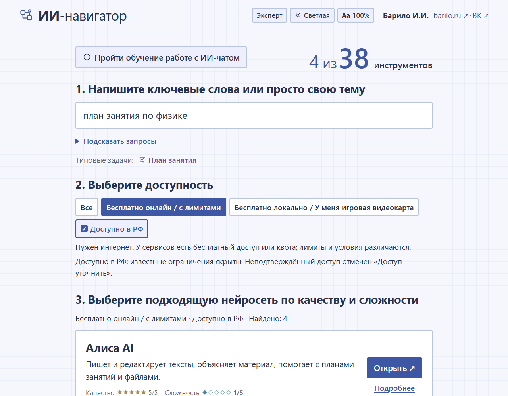
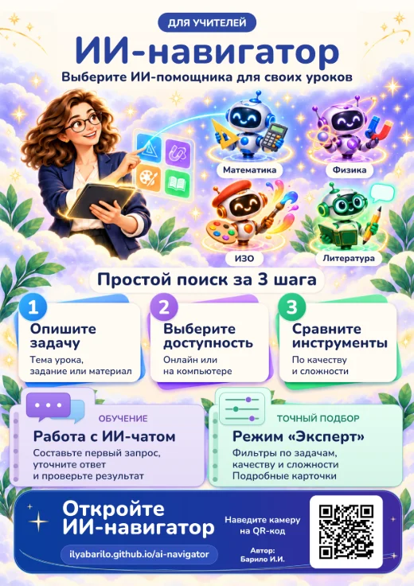
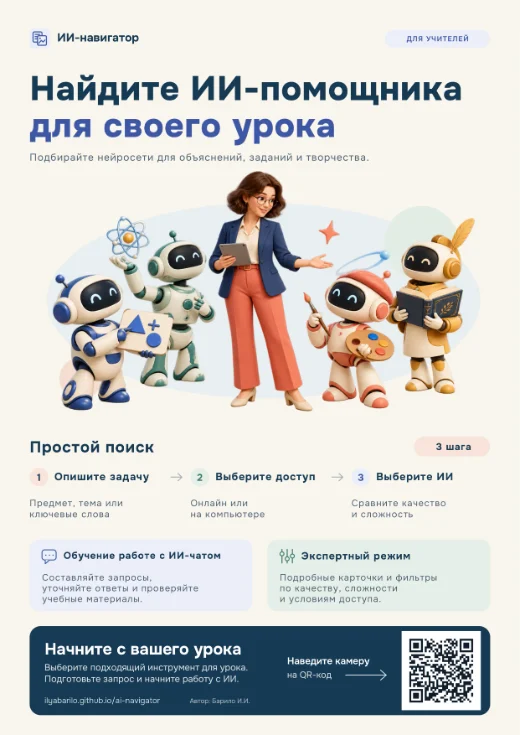

#  ИИ-навигатор

Автономный помощник для преподавателей: подбирает ИИ-инструменты по задаче, условиям доступа, качеству и сложности. Помогает составить первый запрос к ИИ-чату и самостоятельно проверить ответ.

[Запуск и сборка](docs/USAGE.md#запуск) · [Руководство](docs/USAGE.md) · [Код — MIT; условия названия и графики](NOTICE.md)

Проект развивается. Программа открывается одним HTML-файлом; установка и сервер не нужны.

## Быстрый старт

1. [Откройте ИИ-навигатор](https://ilyabarilo.github.io/ai-navigator/) и начните подбор.
2. Можно [скачать автономный HTML](https://github.com/IlyaBarilo/ai-navigator/releases/latest/download/ai-navigator.html) и пользоваться им без интернета. Скачивание станет доступно после первого выпуска.
3. **Пример:** введите «план занятия по физике», нажмите «Далее», оставьте бесплатный онлайн-доступ и фильтр РФ, затем нажмите «Показать результаты».
4. Выберите подходящий инструмент: «Подробнее» покажет условия, «Открыть» переведёт к сервису.

Для первого опыта [сразу откройте обучение работе с ИИ-чатом](https://ilyabarilo.github.io/ai-navigator/?view=first).

Для открытия онлайн-сервисов и источников нужен интернет; сервис может запросить вход в аккаунт. Навигатор не отправляет запросы за пользователя.

## Возможности

- Режим «По шагам» по умолчанию: описание → доступ → результаты. Простой режим показывает подбор на одном экране, Эксперт — полный набор фильтров.
- Поиск по русским формулировкам, названиям и синонимам задач.
- Бесплатные онлайн- и локальные варианты, отдельный фильтр доступности из РФ.
- Оценки конкретных возможностей, аппаратные требования и ссылки на источники.
- Учебные примеры запросов, светлая и тёмная темы, изменение размера текста.
- На телефоне — отключаемый помощник для ввода задачи, выбора доступности и перехода к обучению.

Для самого навигатора игровая видеокарта не требуется. Она рекомендуется для локальных ИИ-приложений; конкретные требования указаны в их карточках.

## Постеры для печати

Два варианта А4 с QR-кодом для открытия приложения. Нажмите на превью, чтобы открыть полноразмерный WebP, сохраните его и распечатайте на листе А4 в книжной ориентации.

<!-- GENERATED_ASSET: Reduced previews of the supplied A4 posters; print files retain their original resolution. -->

[Вариант 1 — WebP для печати](docs/posters/ai-navigator-poster-a4-v1.webp) · [Вариант 2 — WebP для печати](docs/posters/ai-navigator-poster-a4-v2.webp)

Эти два постера разрешено печатать и размещать без изменений: [условия использования](BRANDING.md#постеры-для-печати).

## Документация

- [Подбор, обучение, настройки и решение частых затруднений](docs/USAGE.md).
- [Для разработчика: данные, сборка, проверки и выпуски](docs/DEVELOPMENT.md).
- [Лицензии и состав поставки](NOTICE.md).

## Ограничения

Оценки качества и сложности субъективны. Описания могут содержать ошибки, в том числе после подготовки с помощью ИИ. Возможности, тарифы, квоты, доступность и условия использования результатов проверяйте у самих сервисов. Отметка «доступ уточнить» означает отсутствие подтверждения; бесплатный доступ может иметь лимиты.

Не вводите в учебные запросы персональные данные, закрытые документы и сведения о конкретных учащихся. Ответ внешнего ИИ необходимо проверить самостоятельно.

## Обратная связь

Вопросы, замечания к описаниям и предложения можно [направить автору в ВК](https://vk.ru/id4022887). Не публикуйте в обращениях пароли, ключи и закрытые материалы.

## Автор и условия использования

Автор — [Барило И.И.](https://barilo.ru/).

Собственный код, документация и обычные значки — [MIT](LICENSE). Авторские [учебные примеры](EDUCATIONAL-MATERIALS.md) требуют отдельного разрешения. Название и фирменная графика требуют отдельного разрешения, кроме печати и размещения двух неизменённых постеров: [условия брендинга](BRANDING.md). [Полная карта условий](NOTICE.md).
